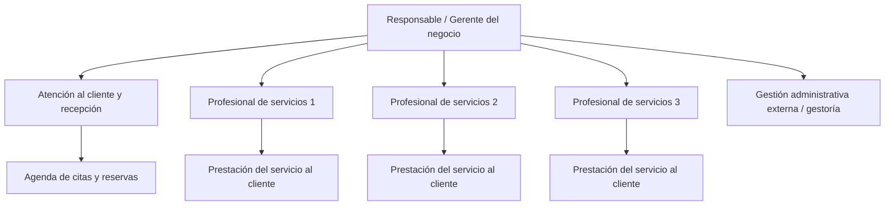

# 01 · Análisis y documentación inicial (RA1)

> **Plantilla.** Se entrega como **H1 el 26-nov-2026**. Cada apartado indica el criterio de evaluación (CE) que evidencia y qué se espera. Borra las notas en cursiva al rellenar.

## 1. Sector y empresas (CE 1a, 1b)

### 1.1 Clasificación de empresas del sector

El sector de referencia son los **servicios con cita previa** gestionados por autónomos y pequeñas empresas (belleza y bienestar, fisioterapia, limpiezas a domicilio, clases particulares, consultoría…), así como los proveedores de software que les dan soporte. A continuación se clasifican 6 empresas representativas por sus características organizativas y el producto o servicio que ofrecen.

| # | Empresa | Tipo organizativo y tamaño | Producto o servicio | Modelo de negocio | Enlace y fecha de acceso | Estado (`leído` / `sin leer`) |
|:---:|---|---|---|---|---|---|
| E1 | **Setmore** | Empresa tecnológica (SaaS) · internacional, mediana | Software de programación de citas online con versión gratuita y planes de pago | Suscripción (freemium) | [setmore.com](https://www.setmore.com/) · 2026-11-15 | `leído` |
| E2 | **Square Appointments** | Gran corporación tecnológica · multinacional | Sistema de reservas todo en uno (agenda, pagos, recordatorios, TPV) | Suscripción + comisión por transacción | [squareup.com/us/en/appointments](https://squareup.com/us/en/appointments) · 2026-11-15 | `leído` |
| E3 | **SimplyBook.me** | Empresa tecnológica (SaaS) · internacional, pequeña/mediana | Software de reservas online para negocios de servicios | Suscripción por niveles | [simplybook.me](https://simplybook.me/) · 2026-11-15 | `leído` |
| E4 | **Eskedula** | PYME española de software · pequeña | Gestión de reservas, agenda, clientes, TPV y facturación para belleza y bienestar | Suscripción / licencia | [eskedula.es](https://www.eskedula.es/) · 2026-11-15 | `leído` |
| E5 | **Booksy** | Empresa tecnológica (SaaS / marketplace) · internacional | Marketplace y software de reservas para belleza, bienestar y salud | Suscripción + comisión por reserva | [booksy.com/biz](https://booksy.com/biz/en-us) · 2026-11-15 | `leído` |
| E6 | **Fresha** | Empresa tecnológica (SaaS / marketplace) · internacional | Software gratuito de reservas y pagos para belleza y bienestar, monetizado mediante comisiones y funciones premium | Comisión por transacción + suscripción premium | [fresha.com/for-business](https://www.fresha.com/for-business) · 2026-11-15 | `leído` |

### 1.2 Empresa tipo (modelo organizativo habitual del sector)

A continuación se describe una **empresa tipo del sector usuario**, basada en características organizativas frecuentes en PYMEs de servicios con cita previa (belleza, bienestar, fisioterapia, limpiezas a domicilio…). No se atribuye a ninguna empresa concreta; es un modelo representativo del colectivo objetivo.

**Sector:** Servicios personales y profesionales con cita previa (belleza y bienestar, fisioterapia, limpieza a domicilio, clases particulares, consultoría…)  
**Tamaño típico:** 3 a 6 personas, contando al responsable  
**Forma jurídica típica:** Autónomo con empleados o sociedad limitada pequeña  
**Problema habitual:** la persona responsable gestiona las citas manualmente (llamadas, WhatsApp, agenda de papel), lo que genera solapamientos, olvidos y tiempo perdido atendiendo el teléfono fuera de horario.

#### Organigrama (Mermaid) — modelo organizativo típico

#### Funciones de cada puesto o departamento (modelo típico)

| Puesto o departamento | Funciones principales |
|-----------------------|----------------------|
| **Responsable / Gerente del negocio** | Toma de decisiones, definición de horarios de apertura y disponibilidad, supervisión general, atención de problemas operativos, contacto con proveedores y con la gestoría externa. |
| **Atención al cliente y recepción** | Atender llamadas y mensajes, anotar citas en la agenda, confirmar reservas, gestionar cancelaciones y cambios de horario, atender al cliente en el local. |
| **Profesionales de servicios** | Prestar el servicio contratado (estética, masaje, fisioterapia, limpieza, clases…), preparar el espacio y el material antes y después de cada cliente, registrar los servicios realizados. |
| **Gestión administrativa externa (gestoría)** | Llevar la contabilidad, facturación a clientes, nóminas de empleados, declaraciones fiscales y Seguridad Social. |

Este modelo organizativo refleja la realidad de muchas PYMEs del sector: equipos pequeños sin departamento de sistemas, que dependen en gran medida de la gestión manual del tiempo y de las citas.

## 2. Necesidades y oportunidades (CE 1c, 1d)

### 2.1 Necesidades detectadas (priorizadas)

Criterio de priorización: impacto directo en el tiempo del empresario (horas/semana salvadas o recuperadas) y frecuencia con la que se da el problema en el colectivo objetivo. Fuente principal: experiencia directa (documentada en el punto 4 de `00-documentoInicio.md`) y datos de afiliación del Ministerio de Trabajo y Economía Social (MITES) y UPTA, cruzados con estudios de conciliación laboral.

| Prioridad | Necesidad | Colectivo afectado | Fuente | Criterio de priorización |
|:---:|---|---|---|---|
| 1 | Gestión centralizada de citas y reservas (evitar llamadas, WhatsApp y agenda de papel dispersos) | Autónomos y pymes de servicios (peluquería, estética, fisioterapia, consultoría, clases particulares…) | MITES (abril 2026): 3.463.806 autónomos en España; UPTA (junio 2026): 3.490.048 | Afecta a casi todo el colectivo; es el desgaste diario más repetido |
| 2 | Definir y controlar horarios de disponibilidad propios (bloques, descansos, días no laborables, límite diario de citas) | Trabajadores por cuenta propia que gestionan su propia agenda | UPTA: estudio de racionalización de los tiempos de trabajo del autónomo (2021) | Evita el desbalance vida-laboral que declara el propio empresario |
| 3 | Reducir ausencias sin aviso y olvidos de cita (recordatorios automáticos) | Negocios con cita previa | Práctica habitual del sector (consultado en catálogos de software de reservas: Square, Setmore) | Cada ausencia es ingreso perdido y hueco no rellenable |
| 4 | Página pública de reserva para clientes (disponibilidad visible sin intervenir el empresario) | Empresarios que quieren captar clientes sin depender de redes sociales | Análisis de las 6 empresas del apartado 1.1: las seis ofrecen página pública de reserva | Diferencia entre tener que atender el teléfono o que el cliente reserve solo |
| 5 | Historial de clientes y servicios prestados | Negocios con clientela recurrente | Análisis de las 6 empresas del apartado 1.1: todas incluyen historial de clientes | Soporte para la siguiente necesidad (marketing/fidelización) |

### 2.2 Oportunidad de negocio

El colectivo objetivo es numeroso y en crecimiento. Según los datos del Ministerio de Trabajo y Economía Social (estadística de autónomos, abril 2026), en España hay **3.463.806 trabajadores autónomos**, con un crecimiento del **1,25 % interanual** (+42.758 personas respecto a abril de 2025). UPTA sitúa la cifra en junio de 2026 en **3.490.048 autónomos**.

Dado que una parte sustancial de esos autónomos presta servicios con cita previa (belleza y bienestar, salud, formación, consultoría), el mercado potencial de una herramienta de gestión de citas es de varios cientos de miles de negocios solo en España. A nivel mundial, el mercado de software de programación de citas se prevé que crezca de **635,6 millones de dólares en 2026 a 1.905,90 millones de dólares** (Fortune Business Insights), lo que indica una demanda sostenida de este tipo de soluciones.

miCita no pretende cubrir todo ese mercado, sino un segmento concreto: el pequeño empresario autónomo que quiere **control total de su tiempo y equilibrio vida-laboral**, no solo una agenda. Ese enfoque en la personalización y los límites de disponibilidad es el diferenciador frente a soluciones puramente operativas.

### 2.3 Fuentes consultadas

| # | Fuente | Tipo | Fecha de acceso | Fiabilidad | Estado |
|:---:|---|---|---|---|---|
| F1 | Ministerio de Trabajo y Economía Social, [Estadística de autónomos, abril 2026 (PDF)](https://www.mites.gob.es/estadisticas/AUT/AUT_04_2026.pdf) | Dato oficial primario | 2026-11-19 | Alta (organismo público) | `leído` |
| F2 | UPTA, ["Evolución del trabajo autónomo en España durante el primer semestre de 2026"](https://upta.es/upta-analiza-la-evolucion-del-trabajo-autonomo-en-espana-durante-el-primer-semestre-de-2026/) | Informe de organización empresarial representativa | 2026-11-19 | Alta | `leído` |
| F3 | UPTA, "Estudio de racionalización y tiempos de trabajo del autónomo" (2021) | Estudio sectorial | 2026-11-15 | Alta | `leído` |
| F4 | Fortune Business Insights, "Appointment Scheduling Software Market" | Informe de mercado | 2026-11-15 | Media (proyección de mercado privada) | `leído` |
| F5 | Experiencia directa (casos familiares y observación en el entorno) | Experiencia propia | 2026-11-15 | Media (fuente subjetiva, complementaria a los datos oficiales) | no aplica |

## 3. Tipo de proyecto elegido (CE 1e)

### Proyecto propuesto: miCita

miCita es una plataforma web de gestión de citas y reservas diseñada para autónomos que trabajan solos y pequeños empresarios con poco personal que prestan servicios con cita previa (belleza, bienestar, fisioterapia, limpiezas a domicilio, clases particulares, consultoría…).

El núcleo del proyecto es un calendario inteligente y personalizable que permite al empresario definir sus propios horarios de trabajo, bloques, descansos y días de disponibilidad, establecer un límite diario de citas, y publicar solo los horarios que él elige para que los clientes reserven directamente. Cuando hay varios trabajadores y el cliente no elige a uno concreto, el sistema asigna la cita a quien tenga hueco y no muestra como disponible a quien ya está lleno, equilibrando la carga de trabajo sin que nadie se sobrecargue.

### ¿Por qué este proyecto?

Se elige miCita porque responde directamente al problema identificado en el punto 4 de `00-documentoInicio.md`: los trabajadores por cuenta propia gestionan sus citas de forma manual o dispersa (llamadas, WhatsApp, agenda de papel), lo que les quita tiempo de su actividad, genera solapamientos y ausencias sin aviso, y dificulta poner límites a su disponibilidad. El resultado es un desbalance entre el tiempo de trabajo y el tiempo personal.

Los datos del sector confirman la relevancia del proyecto:

- En España hay **3.463.806 trabajadores autónomos** (MITES, abril 2026), con un crecimiento del **1,25 % interanual**.
- UPTA sitúa la cifra en **3.490.048 autónomos** en junio de 2026.
- El mercado mundial de software de programación de citas se prevé que crezca de **635,6 millones de dólares en 2026 a 1.905,90 millones de dólares** (Fortune Business Insights).

Además, el proyecto parte de la experiencia directa del autor: la gestión manual de citas de su madre como autónoma manicurista, y el caso de su tía con limpiezas a domicilio en Suiza, donde la distancia geográfica y el transporte hacen necesaria una planificación de calendario adaptada a regiones específicas.

### Alternativas consideradas y por qué no se eligen

| Alternativa | Qué ofrece | Por qué no se elige como proyecto principal |
|-------------|------------|---------------------------------------------|
| **Software de reservas existente** (Setmore, Square Appointments, SimplyBook.me, Eskedula, Booksy, Fresha) | Herramientas ya consolidadas para gestionar citas online | Son soluciones genéricas y operativas; no ponen el énfasis en el control total del tiempo del empresario ni en el equilibrio vida-laboral. Además, muchas son de pago y no se adaptan a la realidad de autónomos que trabajan solos con recursos limitados. |
| **Hoja de cálculo o agenda de papel** | Método manual, sin coste tecnológico | Es la situación actual del problema: genera solapamientos, olvidos, tiempo perdido y sin límites de disponibilidad. No resuelve la necesidad. |
| **Desarrollar una aplicación móvil nativa** | App para iOS y Android | Requeriría doble desarrollo (iOS y Android), mayor tiempo y coste. Una plataforma web accesible desde navegador cubre la necesidad de forma más rápida y accesible tanto para el empresario como para el cliente. |

### Decisión final

Se elige desarrollar **miCita como plataforma web** (HTML, CSS, JavaScript en el cliente; Java con Spring Boot en el servidor; base de datos SQL) porque:

- Es la respuesta más directa al problema de control del tiempo y disponibilidad del autónomo.
- Se adapta a los usuarios identificados (autónomos solos y pequeños empresarios con poco personal).
- Permite una primera versión mínima funcional antes del 31-mar-2027 con las 4 funcionalidades imprescindibles definidas en el punto 6 de `00-documentoInicio.md`.
- Integra contenidos reales de al menos tres módulos de 2.º (entorno cliente, entorno servidor, despliegue y diseño de interfaces).
- No requiere datos personales reales; se trabajará con datos de ejemplo.

Este proyecto se plantea como un **encargo simulado**, no parte de una empresa real, y no usará datos personales reales.

## 4. Requisitos y restricciones (CE 1f)

> **Guía.** Numera los requisitos **funcionales** como **RF-01, RF-02…** (qué hace el sistema) y los **no funcionales** como **RNF-01…** (cómo lo hace: rendimiento, seguridad, usabilidad, disponibilidad, accesibilidad). Las **restricciones** (plazo, presupuesto, tecnología obligatoria, normativa) como **REST-01…**. Cada requisito debe tener **una medida o una prueba**. Si aún no sabes cómo lo probarás, escribe «pendiente» y complétalo antes de H3.

| ID | Requisito | Tipo (funcional / no funcional / restricción) | Cómo se verifica |
|---|---|---|---|
| RF-01 | El empresario debe poder configurar sus horarios de trabajo, bloques, descansos y días no laborables por semana. | funcional | El sistema permite definir al menos 5 franjas horarias semanales y las almacena en la base de datos. Se verifica que al cargar el calendario se muestran correctamente. |
| RF-02 | El empresario debe poder establecer un límite diario de citas. | funcional | Si el límite es 5 citas, al intentar crear la 6ª cita del mismo día el sistema la rechaza y muestra mensaje de "cupo completo". |
| RF-03 | El empresario debe poder crear, editar y cancelar citas desde el panel del empresario. | funcional | Se puede crear una cita con fecha, hora, cliente y servicio; se visualiza en el calendario; se puede editar y eliminar sin errores. |
| RF-04 | Debe existir una página pública de disponibilidad donde el cliente vea los horarios libres y reserve una cita sin intervención del empresario. | funcional | Un usuario no autenticado accede a la página pública, selecciona una hora libre y reserva; la cita aparece en el calendario del empresario. |
| RF-05 | Cuando el cliente no elige un trabajador concreto, el sistema debe asignar la cita a quien tenga hueco y no mostrar como disponible a quien ya esté lleno. | funcional | Si el trabajador A tiene su cupo diario lleno, no aparece en la lista de trabajadores disponibles para ese horario. |
| RF-06 | El sistema debe permitir consultar el historial de clientes y servicios prestados. | funcional | Al buscar un cliente por nombre o teléfono, el sistema muestra sus citas pasadas y servicios realizados. |
| RF-07 | El sistema debe enviar recordatorios automáticos de cita con al menos 24 horas de antelación. | funcional | Se configura una cita para mañana; el sistema genera un recordatorio (correo o notificación) 24h antes y queda constancia en el registro de envíos. |
| RNF-01 | La API de consulta de disponibilidad debe responder en menos de 2 segundos. | no funcional | Se mide el tiempo de respuesta del endpoint `GET /api/availability` con 10 consultas consecutivas; el promedio debe ser < 2 s. |
| RNF-02 | La plataforma debe estar disponible el 99 % del tiempo en horario laboral (08:00-20:00). | no funcional | Se monitoriza el tiempo de actividad del servidor durante una semana; el uptime debe ser ≥ 99 %. |
| RNF-03 | La interfaz debe cumplir con las pautas de accesibilidad WCAG 2.1 nivel AA. | no funcional | Se ejecuta una herramienta de auditoría de accesibilidad (axe o similar) sobre la página pública y el panel del empresario; no debe haber errores críticos. |
| RNF-04 | Las contraseñas de los empresarios deben almacenarse con hash y sal, nunca en texto plano ni cifradas de forma reversible. | no funcional | Se inspecciona la base de datos y se verifica que la columna de contraseña contiene un hash con sal (BCrypt) y no la contraseña original. |
| REST-01 | La primera versión mínima debe estar funcionando antes del 31-mar-2027. | restricción | Se comprueba la fecha de entrega del despliegue en el servidor y la funcionalidad de las 4 funcionalidades imprescindibles. |
| REST-02 | No se usarán datos personales reales; solo datos de ejemplo. | restricción | Se revisa que la base de datos de pruebas contenga únicamente nombres, teléfonos y emails ficticios. |
| REST-03 | El backend debe desarrollarse con Java 21 y Spring Boot, y la base de datos debe ser SQL (MySQL o PostgreSQL). | restricción | Se verifica en el repositorio (pom.xml/build.gradle y configuración de conexión a BD) que se usan las tecnologías indicadas. |

### Matriz de trazabilidad

> **Guía.** Ejemplo ficticio: *OBJ-01 Gestionar citas → RF-02 Crear una cita → CU-03 → `POST /citas` → prueba P-07.* Cada RF y cada RNF de la tabla anterior debe aparecer aquí. También se incluyen las REST para que el tutor pueda revisarlas junto a los objetivos.

| Objetivo | Requisito | Caso de uso | Pantalla o endpoint | Prueba o indicador |
|---|---|---|---|---|
| OBJ-01 Controlar la disponibilidad del empresario; se cumple cuando se configuran al menos 5 franjas semanales y un límite diario que el sistema respeta. | RF-01, RF-02 | CU-01 Configurar calendario | Panel del empresario / `POST /api/schedules` | P-01: se definen 5 franjas horarias y se almacenan; se rechaza la cita que supera el límite diario. |
| OBJ-01 Controlar la disponibilidad del empresario; se cumple cuando se configuran al menos 5 franjas semanales y un límite diario que el sistema respeta. | REST-01 | — | Despliegue / entrega | P-07: la versión mínima con las 4 funcionalidades imprescindibles está desplegada antes del 31-mar-2027. |
| OBJ-02 Gestionar citas del negocio; se cumple cuando el empresario puede crear, editar y cancelar una cita y verla en el calendario. | RF-03 | CU-02 Crear/editar/cancelar cita | Panel del empresario / `POST /api/appointments` | P-02: se crea, edita y cancela una cita y el calendario se actualiza correctamente. |
| OBJ-02 Gestionar citas del negocio; se cumple cuando el empresario puede crear, editar y cancelar una cita y verla en el calendario. | RNF-04 | CU-01/CU-02 | Base de datos / autenticación | P-08: la contraseña se guarda como hash BCrypt con sal, no en texto plano. |
| OBJ-02 Gestionar citas del negocio; se cumple cuando el empresario puede crear, editar y cancelar una cita y verla en el calendario. | REST-02 | — | Base de datos de pruebas | P-09: la base de datos de pruebas contiene solo datos ficticios. |
| OBJ-02 Gestionar citas del negocio; se cumple cuando el empresario puede crear, editar y cancelar una cita y verla en el calendario. | REST-03 | — | Repositorio / configuración | P-10: el repositorio usa Java 21, Spring Boot y una base de datos SQL. |
| OBJ-03 Permitir la reserva online al cliente; se cumple cuando un cliente no autenticado reserva una hora libre y la cita queda registrada. | RF-04 | CU-03 Reservar cita | Página pública / `GET /api/availability`, `POST /api/bookings` | P-03: cliente reserva una hora libre y la cita queda registrada en el calendario. |
| OBJ-03 Permitir la reserva online al cliente; se cumple cuando un cliente no autenticado reserva una hora libre y la cita queda registrada. | RNF-01 | CU-03 Reservar cita | `GET /api/availability` | P-11: 10 consultas consecutivas a disponibilidad responden con promedio < 2 s. |
| OBJ-03 Permitir la reserva online al cliente; se cumple cuando un cliente no autenticado reserva una hora libre y la cita queda registrada. | RNF-02 | CU-03 Reservar cita | Plataforma desplegada | P-12: se revisa el uptime en una semana de pruebas y se registra el resultado. |
| OBJ-03 Permitir la reserva online al cliente; se cumple cuando un cliente no autenticado reserva una hora libre y la cita queda registrada. | RNF-03 | CU-03 Reservar cita | Página pública / panel | P-13: auditoría con axe (o similar) sin errores críticos de accesibilidad. |
| OBJ-04 Distribuir citas entre trabajadores; se cumple cuando un trabajador con cupo lleno no aparece disponible. | RF-05 | CU-04 Asignar cita automática | Página pública / `GET /api/workers/available` | P-04: trabajador con cupo completo no aparece como disponible. |
| OBJ-05 Consultar el historial de clientes; se cumple cuando se muestra el historial de un cliente existente. | RF-06 | CU-05 Consultar historial | Panel del empresario / `GET /api/customers/{id}/history` | P-05: al buscar un cliente se muestran sus citas pasadas y servicios. |
| OBJ-06 Reducir ausencias; se cumple cuando se genera un recordatorio 24 h antes de la cita y queda constancia. | RF-07 | CU-06 Enviar recordatorio | Servicio backend / `POST /api/reminders` | P-06: se genera/envía el recordatorio 24 h antes y queda registro del envío. |

## 5. Obligaciones fiscales, laborales y de prevención (CE 1g)

miCita se plantea como un **encargo simulado** (no parte de una empresa real, no hay empleados ni datos personales reales). A continuación se indican las obligaciones normativas que aplicarían si el proyecto se pusiera en marcha de forma real, con su norma de referencia y las condiciones de aplicación.

### 5.1 Protección de datos personales

| Obligación | Norma | Condiciones de aplicación | Estado |
|:---|:---|:---|:---|
| Cumplir con la protección de datos de los clientes (nombres, teléfonos, emails, historial de citas) | [Reglamento (UE) 2016/679 (RGPD)](https://eur-lex.europa.eu/eli/reg/2016/679/oj?locale=es) | Si la plataforma trata datos personales de personas físicas (clientes que reservan citas), el empresario es responsable del tratamiento. Debe informar a los usuarios, obtener su consentimiento cuando sea necesario, permitir el ejercicio de derechos (acceso, rectificación, supresión, portabilidad) y notificar brechas de seguridad. | `leído` |
| Adaptar la protección de datos al ordenamiento español | [Ley Orgánica 3/2018 (LOPDGDD)](https://www.boe.es/buscar/act.php?id=BOE-A-2018-16673) | Completa el RGPD en España. Exige llevar un registro de las actividades de tratamiento y designar un delegado de protección de datos cuando se traten datos a gran escala o categorías especiales (art. 34 LOPDGDD). | `leído` |
| Informar sobre el uso de cookies y servicios de la sociedad de la información | [Ley 34/2002 (LSSI)](https://www.boe.es/buscar/act.php?id=BOE-A-2002-13758) | Al ser una plataforma web accesible al público, debe informar sobre cookies, incluir aviso legal, política de privacidad y política de cookies, y permitir el contacto con el responsable del sitio. | `leído` |

### 5.2 Obligaciones fiscales (si el proyecto fuera un negocio real)

| Obligación | Norma | Condiciones de aplicación | Estado |
|:---|:---|:---|:---|
| Alta en el censo de empresarios, profesionales y retenedores | [Real Decreto 1065/2007](https://www.boe.es/buscar/act.php?id=BOE-A-2007-15984) | El autónomo o empresario debe darse de alta en Hacienda mediante el modelo 036 antes de iniciar la actividad, indicando el epígrafe del IAE correspondiente (por ejemplo, servicios de informática o agenciación). | `leído` |
| Declaración y liquidación del IVA | [Ley 37/1992, del Impuesto sobre el Valor Añadido](https://www.boe.es/buscar/act.php?id=BOE-A-1992-28740) | Si se cobra por el uso de la plataforma o por reservas, se deben emitir facturas con IVA y presentar liquidaciones periódicas (modelos 303 y 390). | `leído` |
| Declaración del IRPF | [Ley 35/2006, del IRPF](https://www.boe.es/buscar/act.php?id=BOE-A-2006-20764) y [Real Decreto 439/2007](https://www.boe.es/buscar/act.php?id=BOE-A-2007-6820) | Los ingresos obtenidos por la actividad se declaran en el IRPF (modelo 100 anual y, si procede, pagos fraccionados modelo 130). | `leído` |

### 5.3 Obligaciones laborales y de prevención de riesgos

| Obligación | Norma | Condiciones de aplicación | Estado |
|:---|:---|:---|:---|
| Prevención de riesgos laborales en el puesto de trabajo | [Ley 31/1995, de Prevención de Riesgos Laborales](https://www.boe.es/buscar/act.php?id=BOE-A-1995-24292) | Si el empresario contrata empleados para gestionar la plataforma, debe evaluar los riesgos (incluidos los ergonómicos y psicosociales del trabajo con ordenador), formar a los trabajadores y garantizar un entorno seguro. En el caso de un autónomo sin empleados, esta obligación no se activa directamente, pero es de aplicación si hay asalariados. | `leído` |
| Alta en la Seguridad Social | [Real Decreto Legislativo 8/2015 (LGSS)](https://www.boe.es/buscar/act.php?id=BOE-A-2015-11724) | El autónomo debe estar dado de alta en el Régimen Especial de Trabajadores Autónomos (RETA). Si hubiera empleados, se darían de alta en el Régimen General y se pagarían las cotizaciones correspondientes. | `leído` |

### 5.4 Consideraciones para este proyecto (encargo simulado)

- **No hay empresa real** detrás de miCita en esta fase académica.
- **No se usan datos personales reales**; la base de datos de pruebas contiene únicamente datos de ejemplo ficticios.
- **No hay empleados contratados**, por lo que no se activan obligaciones laborales ni de PRL directas en este momento.
- Si el proyecto se convirtiera en un producto real, el empresario debería cumplir con todo lo anterior antes de captar clientes y tratar sus datos.

## 6. Ayudas y subvenciones (CE 1h)

miCita es un proyecto de digitalización para pequeños negocios, por lo que las ayudas más relevantes son las orientadas a la incorporación de tecnología en pymes y autónomos. A continuación se recogen ayudas reales, con su estado a fecha de consulta (noviembre de 2026).

### 6.1 Programa Kit Digital (Red.es)

| Concepto | Información |
|:---|:---|
| **Qué es** | Programa de bonos para que pymes, microempresas y autónomos contraten soluciones digitales (web, comercio electrónico, gestión de clientes, facturación, ciberseguridad…). |
| **Organismo** | Red.es, con financiación de fondos europeos Next Generation EU (Plan de Recuperación, Transformación y Resiliencia). |
| **Importe** | Hasta **3.000 €** para autónomos y microempresas de 0 a 2 empleados (Segmento III). Hasta 12.000 € (Segmento I) y 6.000 € (Segmento II) para pymes mayores. |
| **Requisitos** | Ser pyme, microempresa o persona en situación de autoempleo; estar en el censo de empresarios de Hacienda; estar al corriente con Hacienda y Seguridad Social; no ser empresa en crisis; respetar el límite de ayudas de minimis; realizar el test de madurez digital de Acelera pyme. |
| **Plazo** | Las convocatorias **finalizaron el 31 de octubre de 2025**. A noviembre de 2026 no hay convocatoria abierta; distintas fuentes del sector (por ejemplo, portales de ayudas de Asturias) apuntan a un posible remanente de fondos para el Segmento III, pero no hay un plazo publicado y confirmado, así que se considera cerrado. |
| **Fuente** | Red.es / Acelera pyme: [acelerapyme.gob.es](https://www.acelerapyme.gob.es) y [kitdigital.red.es](https://www.kitdigital.red.es). Consulta: 2026-11-15. |
| **Estado de la fuente** | `leído` |

Aunque el programa está cerrado a nuevas solicitudes, se incluye porque es la ayuda de referencia para este tipo de proyecto y porque una futura convocatoria con fondos remanentes podría reabrirla.

### 6.2 Ayudas locales y autonómicas en Asturias y Gijón (2026)

Como el proyecto se sitúa en Asturias, las ayudas que realmente puede solicitar un autónomo o una microempresa de la zona son las convocadas por el **Ayuntamiento de Gijón / Gijón Impulsa**, el **Principado de Asturias** y las **cámaras de comercio** de Gijón y Avilés. Son convocatorias anuales de concurrencia competitiva, salvo DIGICOM, que es una subvención nominativa.

| Ayuda | Organismo | Importe | Plazo 2026 | Estado a 2026-11-15 | Fuente leída |
|:---|:---|:---|:---|:---|:---|
| **Incentivos Impulsa — Subvenciones al Emprendimiento, Innovación y Crecimiento Empresarial** (Línea I Aceleración de Proyectos, Línea II Innovación Abierta, Línea III Crecimiento Empresarial) | Ayuntamiento de Gijón / Gijón Impulsa | 930.000 € en total. Línea I: hasta 6.000 € (personas físicas) y 2.000–3.000 € (autónomos y empresas). Línea II: hasta 34.000 € (75–80 % del presupuesto elegible). Línea III: 80 % hasta 18.000 € | 1.er plazo: 8–27 abr 2026. 2.º plazo: 1–20 sep 2026 | Cerrado (primer plazo resuelto en junio de 2026; segundo plazo cerrado el 20-sep-2026) | `leído` |
| **Ayudas para el impulso empresarial de autónomos, microempresas y pymes** (BDNS 900148) | Principado de Asturias — Consejería de Ciencia, Industria y Empleo | 800.000 €. 50 % de la inversión, máximo 10.000 € por beneficiario; inversión mínima 3.000 € | 2–15 jun 2026 (10 días hábiles desde el BOPA de 1-jun-2026) | Cerrado | `leído` |
| **Programa Pyme Sostenible 2026** (BDNS 887403) | Cámara de Comercio de Gijón | Hasta 4.494 € por empresa (74.900 € de presupuesto) | Hasta 16-oct-2026 | Cerrado | `leído` |
| **Programa Pyme Digital 2026** (BDNS 927280) | Cámara de Comercio de Avilés | Hasta 7.000 € por empresa (44.940 € de presupuesto) | Hasta 16-oct-2026 | Cerrado | `leído` |
| **DIGICOM 2026 — Programa de Digitalización del Comercio Local** (BDNS 916451) | Ayuntamiento de Gijón → Unión de Comerciantes del Principado de Asturias | 400.000 € | 1-jul → 31-dic-2026 | Periodo abierto, pero es una **subvención nominativa**: la solicita y ejecuta la Unión de Comerciantes, no el autónomo directamente | `leído` |

**Requisitos habituales** (según las bases de cada convocatoria): estar dado de alta en el censo de Hacienda y en el IAE, tener domicilio fiscal o establecimiento permanente en Gijón / Asturias, estar al corriente con Hacienda y la Seguridad Social, acreditar una antigüedad mínima de actividad (el impulso empresarial del Principado exige 2 años y constitución posterior al 1-ene-2019), no haber recibido la misma ayuda en los tres ejercicios anteriores y respetar el límite de *minimis* (Reglamento UE 2023/2831).

**Observaciones relevantes para miCita:**

- La ayuda del Principado **excluye expresamente el material informático y los teléfonos móviles**, y solo financia obras, maquinaria, instalaciones y mobiliario nuevos: no serviría para contratar el desarrollo de una web o una app.
- La Línea II de Gijón Impulsa (Innovación Abierta) es la que mejor encaja con un proyecto de software, porque financia proyectos de innovación en colaboración con empresas tractoras.
- A 2026-11-15 **no hay ninguna convocatoria asturiana abierta** para solicitar individualmente: todas las de 2026 están resueltas o cerradas. Al ser convocatorias anuales, la previsión realista es solicitarlas en 2027.

**Fuentes:** Ayuntamiento de Gijón, *Gijón impulsa abre el plazo de solicitud de tres líneas de ayuda* (1-sep-2026), [gijon.es](https://www.gijon.es/es/noticias/gijon-impulsa-solicitud-lineas-ayuda-impulsar-proyectos); BOPA de 1-jun-2026, extracto de la convocatoria de impulso empresarial (BDNS 900148), [asturias.es](https://www.asturias.es/bopa/2026/06/01/2026-03264.pdf); Base de Datos Nacional de Subvenciones, fichas 887403, 916451 y 927280, [infosubvenciones.es](https://www.infosubvenciones.es). Consulta: 2026-11-15.

### 6.3 Línea ICO Empresas y Emprendedores

| Concepto | Información |
|:---|:---|
| **Qué es** | Financiación (préstamo) del Instituto de Crédito Oficial para proyectos empresariales, incluida la digitalización. No es una subvención a fondo perdido. |
| **Requisitos** | Ser autónomo o empresa con domicilio en España, viabilidad del proyecto y cumplimiento de los requisitos de cada línea. |
| **Plazo** | Las condiciones y disponibilidad cambian por línea; conviene consultar directamente en la web del ICO. |
| **Fuente** | Instituto de Crédito Oficial: [ico.es](https://www.ico.es). Consulta: 2026-11-15. |
| **Estado de la fuente** | `leído` |

### 6.4 Conclusión para el proyecto

Para miCita, si se pusiera en marcha como negocio real en Asturias, la vía más coherente sería la **Línea II (Innovación Abierta) de Gijón Impulsa** para la fase de desarrollo, y el **impulso empresarial del Principado** solo para inversión en local o equipamiento (no para software). El **Kit Digital** cubriría la parte de soluciones digitales si se reabriera una convocatoria con fondos remanentes, y la línea **ICO** serviría como financiación complementaria, no como subvención. Como se trata de un encargo simulado, estas ayudas se documentan a título informativo y no se solicitarán durante el proyecto.

## 7. Guion de trabajo (CE 1i)

El proyecto lo desarrolla **una sola persona**, con el **tutor** como revisor y aprobador en cada entrega. El guion se organiza en fases encadenadas: cada una empieza cuando la anterior tiene su entregable cerrado, y las fechas se apoyan en las entregas reales del curso (H1 el 26-nov-2026, H2 el 21-ene-2027, la primera versión mínima antes del 31-mar-2027, según REST-01, y H3 el 7-may-2027).

### 7.1 Fases y dependencias

| Fase | Periodo | Objetivo | Entregable | Depende de |
|:---:|:---|:---|:---|:---|
| **F0. Arranque y documentación inicial** | 6 → 26 nov 2026 | Definir el proyecto, el problema, el alcance y el estado del arte | `00-documentoInicio.md` aprobado y `01-analisis.md` completo (**H1**) | — |
| **F1. Análisis del estado del arte** | 26 nov → 15 dic 2026 | Comparar soluciones existentes y justificar las decisiones técnicas | `01b-sota.md` con fuentes y fecha de acceso | F0 (alcance definido) |
| **F2. Diseño y planificación** | 16 dic 2026 → 21 ene 2027 | Modelo de datos, arquitectura, prototipos de interfaz y planificación | `02-diseno.md`, `03-planificacion.md` (pendiente, se crea en H2) y tablero de tareas (**H2**) | F1 (decisiones técnicas) |
| **F3. Preparación del entorno** | en paralelo a F1–F2 (nov 2026 → ene 2027) | Instalar y probar el entorno: JDK, Spring Boot, MySQL/PostgreSQL, Git y un despliegue de prueba | Repositorio con proyecto base que arranca, conecta a la base de datos y se despliega | F0 |
| **F4. Desarrollo de la versión mínima** | 22 ene → 31 mar 2027 | Implementar las 4 funcionalidades imprescindibles (RF-01 a RF-05): calendario configurable, gestión de citas, página pública de reserva y asignación automática entre trabajadores | Versión desplegada y usable con datos de ejemplo | F2 (diseño y modelo de datos) y F3 (entorno) |
| **F5. Funcionalidades opcionales y pruebas** | 1 abr → 30 abr 2027 | Añadir historial de clientes (RF-06) y recordatorios (RF-07); ejecutar las pruebas P-01 a P-13 y la auditoría de accesibilidad (RNF-03) | Registro de pruebas y correcciones aplicadas | F4 (versión mínima estable) |
| **F6. Cierre, memoria y defensa** | 1 may → 7 may 2027 | Documentación final, manual de despliegue, memoria y presentación | Documentación definitiva y defensa (**H3**) | F5 |

### 7.2 Hitos

| Hito | Fecha | Qué queda cerrado | Responsable | Criterio de cierre |
|:---:|:---|:---|:---|:---|
| **H1** | 26 nov 2026 | Documento de inicio y análisis (RA1) | Autor | Los 8 apartados del `01-analisis.md` están completos y el tutor los aprueba |
| **H2** | 21 ene 2027 | Diseño, estado del arte y planificación (RA2 y RA3) | Autor | Modelo de datos y prototipos revisados; cronograma con dependencias y riesgos |
| **MVP** | 31 mar 2027 | Primera versión mínima funcionando | Autor | Las 4 funcionalidades imprescindibles funcionan sobre la aplicación desplegada (REST-01) |
| **Pruebas cerradas** | 30 abr 2027 | Requisitos verificados | Autor | P-01 a P-13 documentadas; sin errores críticos de accesibilidad |
| **H3** | 7 may 2027 | Proyecto completo y memoria | Autor | Documentación, código y despliegue entregados y defensa preparada |

### 7.3 Responsabilidades

| Rol | Persona | Responsabilidad |
|:---|:---|:---|
| **Desarrollo y documentación** | Jhonatan Stiven Albarracin Agudelo | Todas las fases: análisis, diseño, implementación, pruebas, despliegue y memoria |
| **Revisión y aprobación** | Tutor del proyecto | Valida el alcance en H1, revisa el diseño en H2 y evalúa la entrega final (H3) |

### 7.4 Seguimiento

El trabajo se organiza en el **tablero de GitHub Projects** del repositorio [github.com/jhonatan-albarracin/proyectoDAW](https://github.com/jhonatan-albarracin/proyectoDAW), con columnas *Pendiente → En curso → En revisión → Hecho*. Cada tarea se vincula a la **issue** correspondiente y a su rama, y se cierra mediante *pull request* revisado antes de fusionar en `main`. El detalle del cronograma con sus dependencias y el camino crítico se desarrollará en `03-planificacion.md` (pendiente de H2).

## 8. Glosario

Estos son los términos que aparecen en todos los documentos del proyecto. Se usa **siempre** la columna «Término» y nunca los sinónimos de la última columna, para que el mismo concepto se llame igual en el análisis, el diseño, el código y la memoria.

La documentación se redacta en español, pero el código (Java, Spring Boot y SQL) se escribe en inglés. Para que no se mezclen ambos idiomas, se fija la traducción exacta de cada término: es el nombre que se usará en las clases, las tablas y los endpoints.

| Término | Definición | Sinónimos que NO uso |
|---|---|---|
| **Cita** | Encuentro acordado entre un cliente y un trabajador para prestar un servicio en una fecha y hora concretas. Es la unidad que se guarda en la base de datos. *Nombre en el código:* `Appointment`. | turno, *appointment event*, evento |
| **Reserva** | Acción por la que un cliente fija una cita desde la página pública. La reserva crea la cita; por eso el resultado se llama cita y el proceso, reserva. *Nombre en el código:* `Booking`. | solicitud de cita |
| **Calendario** | Configuración de la jornada del negocio y de cada trabajador: franjas horarias, descansos, días no laborables y cupo diario. Es el núcleo de miCita. *Nombre en el código:* `Schedule` (evita `Calendar`: ya existe en `java.util`). | *calendar* |
| **Disponibilidad** | Conjunto de franjas en las que el empresario permite reservas, ya descontadas las citas ocupadas, los descansos y los días no laborables. *Nombre en el código:* `Availability`. | huecos, agenda libre, *slots* |
| **Franja horaria (bloque)** | Intervalo con hora de inicio y hora de fin dentro de un día concreto (por ejemplo, 09:00–14:00). Es la pieza con la que se construye el calendario. *Nombre en el código:* `TimeSlot`. | *slot*, tramo, hueco horario |
| **Descanso** | Intervalo de la jornada que no admite reservas (comida, pausa entre clientes). Se configura como parte del calendario. *Nombre en el código:* `Break`. | pausa, *break time* |
| **Día no laborable** | Día completo en el que el negocio o un trabajador no atiende (por ejemplo, un festivo local, vacaciones o un cierre puntual). Se excluye de la disponibilidad. *Nombre en el código:* `NonWorkingDay`. | día libre, *holiday* |
| **Límite diario de citas (cupo)** | Número máximo de citas que un trabajador acepta en un mismo día. Cuando se alcanza, ese trabajador deja de mostrarse como disponible. *Nombre en el código:* `DailyLimit`. | tope, máximo, *threshold* |
| **Servicio** | Prestación que ofrece el negocio (manicura, limpieza a domicilio, fisioterapia, clase particular…), con una duración y, opcionalmente, un precio. *Nombre en el código:* `ServiceOffering` (no `Service`: choca con la anotación `@Service` de Spring). | producto, artículo, *item* |
| **Trabajador** | Persona del negocio que presta los servicios y tiene su propio calendario y su propio cupo. El empresario también puede ser trabajador. *Nombre en el código:* `Worker`. | recurso, *staff*, *employee* |
| **Empresario** | Usuario con cuenta que configura el negocio, los servicios, los horarios de los trabajadores y las citas. Es el cliente de miCita. *Nombre en el código:* `Owner`. | administrador, dueño, *business owner* |
| **Negocio** | Cuenta que agrupa a un empresario, sus trabajadores, sus servicios y su calendario. Todo dato del sistema pertenece a un negocio. *Nombre en el código:* `Business`. | empresa, cuenta, *tenant* |
| **Cliente** | Persona que reserva y recibe el servicio. En la primera versión no tiene cuenta: reserva desde la página pública con sus datos de contacto. *Nombre en el código:* `Customer`. | usuario final, consumidor, *client* |
| **Asignación automática** | Regla por la que el sistema elige al trabajador que atenderá la cita cuando el cliente no escoge ninguno: se descartan los que no tienen hueco o han agotado su cupo. *Nombre en el código:* `AutoAssignment`. | reparto, distribución, *round robin* |
| **Solapamiento** | Situación en la que dos citas ocupan la misma franja del mismo trabajador. El sistema debe impedirlo al reservar. *Nombre en el código:* `Overlap`. | conflicto, choque de horas, *double booking* |
| **Estado de la cita** | Situación en la que se encuentra una cita: pendiente, confirmada, cancelada o completada. *Nombre en el código:* `AppointmentStatus` (enumeración). | situación, fase, *status* |
| **Recordatorio** | Aviso automático que se envía al cliente un tiempo determinado antes de la cita para reducir las ausencias. *Nombre en el código:* `Reminder`. | notificación, alerta, aviso |
| **Historial** | Lista de citas y servicios ya realizados por un cliente, consultable por el empresario. *Nombre en el código:* `AppointmentHistory`. | registro, historial clínico, *log* |
| **Ausencia sin aviso** | Cita a la que el cliente no acude y que tampoco cancela con antelación; deja un hueco que no se puede reutilizar. *Nombre en el código:* `NoShow`. | plantón, incomparecencia |
| **Página pública** | Vista accesible sin autenticación donde el cliente consulta la disponibilidad y reserva una cita. *Nombre en el código:* `PublicBookingPage`. | *landing*, front, web pública |
| **Panel del empresario** | Zona autenticada donde el empresario configura el calendario, gestiona citas y consulta el historial. *Nombre en el código:* `OwnerDashboard`. | *backoffice*, *dashboard*, administración |
| **Región de servicio** | Zona geográfica donde se presta el servicio a domicilio. Condiciona qué citas se pueden encadenar según la distancia y el transporte disponible. *Nombre en el código:* `ServiceArea`. | zona, área, comarca |
| **Encargo simulado** | Proyecto académico que se plantea como si fuera un encargo profesional, pero sin empresa real detrás, sin clientes reales y sin datos personales reales. *Nombre en el código:* — (no se modela). | empresa ficticia, cliente ficticio |

### 8.1 Convenciones de nombres

Para que el glosario se cumpla de verdad en el código:

- **Clases y entidades:** PascalCase y en singular (`Appointment`, `Customer`, `TimeSlot`).
- **Tablas y columnas SQL:** snake_case y en plural para las tablas (`appointments`, `customers`), singular para las columnas (`start_time`, `worker_id`).
- **Endpoints REST:** en plural y en minúsculas (`GET /api/appointments`, `POST /api/bookings`).
- **Campos JSON:** camelCase (`startTime`, `workerId`).
- **Enums:** los valores se guardan en mayúsculas (`PENDING`, `CONFIRMED`, `CANCELLED`, `COMPLETED`), aunque en la interfaz se muestren en español.

### 8.2 Palabras permitidas fuera del modelo

El glosario fija cómo se llaman las **entidades** del sistema, no todas las palabras del idioma. Por eso estas se pueden usar sin problema cuando se describe la realidad del negocio o la situación actual, siempre que no se conviertan en nombre de una entidad:

- **«Profesional»** y **«empleado»**: válidos al describir los puestos del organigrama (apartado 1.2) o al hablar de nóminas y contratos (apartado 5.3). La entidad del sistema se llama **Trabajador**.
- **«Agenda»**: válida en «agenda de papel» y «agenda de citas» al explicar el problema que se quiere resolver. La entidad se llama **Calendario**.
- **«Horario»**: válido para referirse a los horarios de trabajo o de apertura del negocio. La configuración completa se llama **Calendario**.
- **«Festivo»**: válido para nombrar el motivo de un día no laborable («festivo local»). La entidad se llama **Día no laborable**.
- **«Cliente de miCita»**: cuando se dice que el empresario es el cliente de la plataforma, se refiere al negocio que contrata el servicio, no a la entidad **Cliente** (la persona que reserva).

---

## Criterios de evaluación de este documento (RA1, texto literal)

- **1a)** Se han clasificado las empresas del sector por sus características organizativas y el tipo de producto o servicio que ofrecen.
- **1b)** Se han caracterizado las empresas tipo indicando la estructura organizativa y las funciones de cada departamento.
- **1c)** Se han identificado las necesidades más demandadas a las empresas.
- **1d)** Se han valorado las oportunidades de negocio previsibles en el sector.
- **1e)** Se ha identificado el tipo de proyecto requerido para dar respuesta a las demandas previstas.
- **1f)** Se han determinado las características específicas requeridas al proyecto.
- **1g)** Se han determinado las obligaciones fiscales, laborales y de prevención de riesgos y sus condiciones de aplicación.
- **1h)** Se han identificado posibles ayudas o subvenciones para la incorporación de nuevas tecnologías de producción o de servicio que se proponen.
- **1i)** Se ha elaborado el guión de trabajo que se va a seguir para la elaboración del proyecto.
