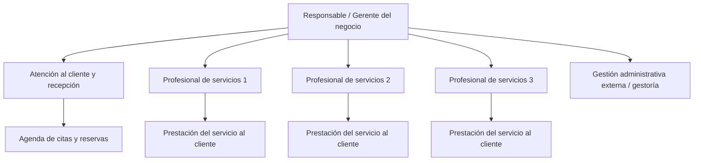

# 01 · Análisis y documentación inicial (RA1)

> **Plantilla.** Se entrega como **H1 el 26-nov-2026**. Cada apartado indica el criterio de evaluación (CE) que evidencia y qué se espera. Borra las notas en cursiva al rellenar.

## 1. Sector y empresas (CE 1a, 1b)

*Clasifica **5 o más** empresas del sector por sus características organizativas y el producto o servicio que ofrecen. Describe con detalle **una empresa tipo**: organigrama (un diagrama Mermaid) y funciones de cada departamento.*

### 1.1 Clasificación de empresas del sector

El sector de referencia son los **servicios con cita previa** gestionados por autónomos y pequeñas empresas (belleza y bienestar, fisioterapia, limpiezas a domicilio, clases particulares, consultoría…), así como los proveedores de software que les dan soporte. A continuación se clasifican 6 empresas representativas por sus características organizativas y el producto o servicio que ofrecen.

| # | Empresa | Tipo organizativo | Tamaño | Producto o servicio | Modelo de negocio |
|:---:|---|---|---|---|---|
| E1 | **Setmore** | Empresa tecnológica (SaaS) | Internacional, mediana | Software de programación de citas online con versión gratuita y planes de pago | Suscripción (freemium) |
| E2 | **Square Appointments** | Gran corporación tecnológica | Multinacional | Sistema de reservas todo en uno (agenda, pagos, recordatorios, TPV) | Suscripción + comisión por transacción |
| E3 | **SimplyBook.me** | Empresa tecnológica (SaaS) | Internacional, pequeña/mediana | Software de reservas online para negocios de servicios | Suscripción por niveles |
| E4 | **Eskedula** | PYME española de software | Pequeña | Gestión de reservas, agenda, clientes, TPV y facturación para belleza y bienestar | Suscripción / licencia |
| E5 | **Booksy** | Empresa tecnológica (SaaS / marketplace) | Internacional | Marketplace y software de reservas para belleza, bienestar y salud | Suscripción + comisión por reserva |
| E6 | **Fresha** | Empresa tecnológica (SaaS / marketplace) | Internacional | Software gratuito de reservas y pagos para belleza y bienestar, monetizado mediante comisiones y funciones premium | Comisión por transacción + suscripción premium |

### 1.2 Empresa tipo (modelo organizativo habitual del sector)

A continuación se describe una **empresa tipo del sector usuario**, basada en características organizativas frecuentes en PYMEs de servicios con cita previa (belleza, bienestar, fisioterapia, limpiezas a domicilio…). No se atribuye a ninguna empresa concreta; es un modelo representativo del colectivo objetivo.

**Sector:** Servicios de belleza y bienestar con cita previa  
**Tamaño típico:** 3 a 6 personas  
**Forma jurídica típica:** Autónomo con empleados o sociedad limitada pequeña  
**Problema habitual:** la persona responsable gestiona las citas manualmente (llamadas, WhatsApp, agenda de papel), lo que genera solapamientos, olvidos y tiempo perdido atendiendo el teléfono fuera de horario.

#### Organigrama (Mermaid) — modelo organizativo típico

#### Funciones de cada puesto o departamento (modelo típico)

| Puesto o departamento | Funciones principales |
|-----------------------|----------------------|
| **Responsable / Gerente del negocio** | Toma de decisiones, definición de horarios de apertura y disponibilidad, supervisión general, atención de problemas operativos, contacto con proveedores y con la gestoría externa. |
| **Atención al cliente y recepción** | Atender llamadas y mensajes, anotar citas en la agenda, confirmar reservas, gestionar cancelaciones y cambios de horario, atender al cliente en el local. |
| **Profesionales de servicios** | Prestar el servicio contratado (estética, masaje, fisioterapia, limpieza, clases…), preparar el espacio y el material antes y después de cada cliente, registrar los servicios realizados. |
| **Gestión administrativa externa (gestoría)** | Llevar la contabilidad, facturación a clientes, nóminas de empleados, declaraciones fiscales y Seguridad Social. |

Este modelo organizativo refleja la realidad de muchas PYMEs del sector: equipos pequeños sin departamento de sistemas, que dependen en gran medida de la gestión manual del tiempo y de las citas.

## 2. Necesidades y oportunidades (CE 1c, 1d)

*Lista **priorizada** de las necesidades más demandadas, con el criterio de priorización y la fuente. Valora las oportunidades de negocio con **al menos un dato cuantitativo** y su fuente.*

### 2.1 Necesidades detectadas (priorizadas)

Criterio de priorización: impacto directo en el tiempo del empresario (horas/semana salvadas o recuperadas) y frecuencia con la que se da el problema en el colectivo objetivo. Fuente principal: experiencia directa del autor (documentada en el punto 4 de `00-documentoInicio.md`) y datos de afiliación del Ministerio de Trabajo y Economía Social (MITES) y UPTA, cruzados con estudios de conciliación laboral.

| Prioridad | Necesidad | Colectivo afectado | Fuente | Criterio de priorización |
|:---:|---|---|---|---|
| 1 | Gestión centralizada de citas y reservas (evitar llamadas, WhatsApp y agenda de papel dispersos) | Autónomos y pymes de servicios (peluquería, estética, fisioterapia, consultoría, clases particulares…) | MITES (abril 2026): 3.463.806 autónomos en España; UPTA (junio 2026): 3.490.048 | Afecta a casi todo el colectivo; es el desgaste diario más repetido |
| 2 | Definir y controlar horarios de disponibilidad propios (bloques, descansos, días festivos, límite diario de citas) | Trabajadores por cuenta propia que gestionan su propia agenda | UPTA: estudio de racionalización de los tiempos de trabajo del autónomo (2021) | Evita el desbalance vida-laboral que declara el propio empresario |
| 3 | Reducir ausencias sin aviso y olvidos de cita (recordatorios automáticos) | Negocios con cita previa | Práctica habitual del sector (consultado en catálogos de software de reservas: Square, Setmore) | Cada ausencia es ingreso perdido y hueco no rellenable |
| 4 | Página pública de reserva para clientes (disponibilidad visible sin intervenir el empresario) | Empresarios que quieren captar clientes sin depender de redes sociales | Mercado de software de reservas (eCommJuice, Setmore) | Diferencia entre tener que atender el teléfono o que el cliente reserve solo |
| 5 | Historial de clientes y servicios prestados | Negocios con clientela recurrente | Necesidad operativa básica de fidelización | Soporte para la siguiente necesidad (marketing/fidelización) |

### 2.2 Oportunidad de negocio

El colectivo objetivo es numeroso y en crecimiento. Según los datos del Ministerio de Trabajo y Economía Social (estadística de autónomos, abril 2026), en España hay **3.463.806 trabajadores autónomos**, con un crecimiento del **1,25 % interanual** (+42.758 personas respecto a abril de 2025). UPTA sitúa la cifra en junio de 2026 en **3.490.048 autónomos**.

Dado que una parte sustancial de esos autónomos presta servicios con cita previa (belleza y bienestar, salud, formación, consultoría), el mercado potencial de una herramienta de gestión de citas es de varios cientos de miles de negocios solo en España. A nivel mundial, el mercado de software de programación de citas se prevé que crezca de **635,6 millones de dólares en 2026 a 1.905,90 millones de dólares** (Fortune Business Insights), lo que indica una demanda sostenida de este tipo de soluciones.

miCita no pretende cubrir todo ese mercado, sino una segmento concreto: el pequeño empresario autónomo que quiere **control total de su tiempo y equilibrio vida-laboral**, no solo una agenda. Ese enfoque en la personalización y los límites de disponibilidad es el diferenciador frente a soluciones puramente operativas.

### 2.3 Fuentes consultadas

| # | Fuente | Tipo | Fecha de acceso | Fiabilidad |
|:---:|---|---|---|---|
| F1 | Ministerio de Trabajo y Economía Social, Estadística de autónomos, abril 2026 (PDF) | Dato oficial primario | 15-nov-2026 | Alta (organismo público) |
| F2 | UPTA, "Evolución del trabajo autónomo en España durante el primer semestre de 2026" | Informe de organización empresarial representativa | 15-nov-2026 | Alta |
| F3 | UPTA, "Estudio de racionalización y tiempos de trabajo del autónomo" (2021) | Estudio sectorial | 15-nov-2026 | Alta |
| F4 | INE, Encuesta de Población Activa, módulo de conciliación vida laboral-familiar | Dato oficial primario | 15-nov-2026 | Alta |
| F5 | Fortune Business Insights, "Appointment Scheduling Software Market" | Informe de mercado | 15-nov-2026 | Media (proyección de mercado privada) |
| F6 | Experiencia directa del autor (casos familiares y observación en el entorno) | Experiencia propia | 15-nov-2026 | Media (fuente subjetiva, complementaria a los datos oficiales) |

## 3. Tipo de proyecto elegido (CE 1e)

*Qué proyecto das como respuesta y por qué, frente a otras alternativas.*

## 4. Requisitos y restricciones (CE 1f)

*Características que debe cumplir el proyecto, redactadas de forma **verificable** (no «debe ser rápido», sino «responde en menos de 2 s»). Parte de lo que has encontrado en [`01b-sota.md`](01b-sota.md).*

> **Guía.** Numera los requisitos **funcionales** como **RF-01, RF-02…** (qué hace el sistema) y los **no funcionales** como **RNF-01…** (cómo lo hace: rendimiento, seguridad, usabilidad, disponibilidad, accesibilidad). Las **restricciones** (plazo, presupuesto, tecnología obligatoria, normativa) como **REST-01…**. Cada requisito debe tener **una medida o una prueba**. Si aún no sabes cómo lo probarás, escribe «pendiente» y complétalo antes de H3.

| ID | Requisito | Tipo (funcional / no funcional / restricción) | Cómo se verifica |
|---|---|---|---|
| RF-01 | [RELLENAR] | funcional | |
| RNF-01 | [RELLENAR] | no funcional | |
| REST-01 | [RELLENAR] | restricción | |

### Matriz de trazabilidad

*Une cada objetivo con sus requisitos, y estos con lo que los implementa y los comprueba. Se rellena por completo al final del proyecto; en H1 basta con **objetivo y requisito**.*

> **Guía.** Ejemplo ficticio: *OBJ-01 Gestionar citas → RF-02 Crear una cita → CU-03 → `POST /citas` → prueba P-07.* Cada RF y cada RNF de la tabla anterior debe aparecer aquí.

| Objetivo | Requisito | Caso de uso | Pantalla o endpoint | Prueba o indicador |
|---|---|---|---|---|
| OBJ-01 [RELLENAR] | RF-01 | | | pendiente |

## 5. Obligaciones fiscales, laborales y de prevención (CE 1g)

*Las obligaciones que aplican a tu proyecto, **con su norma** y sus condiciones.*

## 6. Ayudas y subvenciones (CE 1h)

*Al menos **una** ayuda real: fuente, requisitos y plazo.*

## 7. Guion de trabajo (CE 1i)

*Fases, hitos y responsables del proyecto. Puede enlazar al tablero de GitHub Projects.*

## 8. Glosario

*Una cosa, un nombre: define los términos del dominio y de tu proyecto, y anota los sinónimos que **no** vas a usar en ningún documento. Con **5 términos** basta; crece con el proyecto.*

| Término | Definición | Sinónimos que NO uso |
|---|---|---|
| [RELLENAR] | | |

---

## Criterios de evaluación de este documento (RA1, texto literal)

- **1a)** Se han clasificado las empresas del sector por sus características organizativas y el tipo de producto o servicio que ofrecen.
- **1b)** Se han caracterizado las empresas tipo indicando la estructura organizativa y las funciones de cada departamento.
- **1c)** Se han identificado las necesidades más demandadas a las empresas.
- **1d)** Se han valorado las oportunidades de negocio previsibles en el sector.
- **1e)** Se ha identificado el tipo de proyecto requerido para dar respuesta a las demandas previstas.
- **1f)** Se han determinado las características específicas requeridas al proyecto.
- **1g)** Se han determinado las obligaciones fiscales, laborales y de prevención de riesgos y sus condiciones de aplicación.
- **1h)** Se han identificado posibles ayudas o subvenciones para la incorporación de nuevas tecnologías de producción o de servicio que se proponen.
- **1i)** Se ha elaborado el guión de trabajo que se va a seguir para la elaboración del proyecto.
