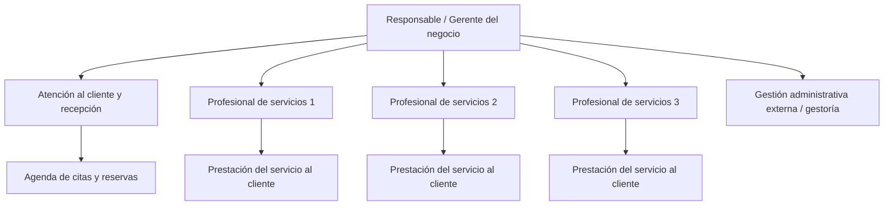

# 01 · Análisis y documentación inicial (RA1)

> **Plantilla.** Se entrega como **H1 el 26-nov-2026**. Cada apartado indica el criterio de evaluación (CE) que evidencia y qué se espera. Borra las notas en cursiva al rellenar.

## 1. Sector y empresas (CE 1a, 1b)

### 1.1 Clasificación de empresas del sector

El sector de referencia son los **servicios con cita previa** gestionados por autónomos y pequeñas empresas (belleza y bienestar, fisioterapia, limpiezas a domicilio, clases particulares, consultoría…), así como los proveedores de software que les dan soporte. A continuación se clasifican 6 empresas representativas por sus características organizativas y el producto o servicio que ofrecen.

| # | Empresa | Tipo organizativo | Tamaño | Producto o servicio | Modelo de negocio |
|:---:|---|---|---|---|---|
| E1 | **Setmore** | Empresa tecnológica (SaaS) | Internacional, mediana | Software de programación de citas online con versión gratuita y planes de pago | Suscripción (freemium) |
| E2 | **Square Appointments** | Gran corporación tecnológica | Multinacional | Sistema de reservas todo en uno (agenda, pagos, recordatorios, TPV) | Suscripción + comisión por transacción |
| E3 | **SimplyBook.me** | Empresa tecnológica (SaaS) | Internacional, pequeña/mediana | Software de reservas online para negocios de servicios | Suscripción por niveles |
| E4 | **Eskedula** | PYME española de software | Pequeña | Gestión de reservas, agenda, clientes, TPV y facturación para belleza y bienestar | Suscripción / licencia |
| E5 | **Booksy** | Empresa tecnológica (SaaS / marketplace) | Internacional | Marketplace y software de reservas para belleza, bienestar y salud | Suscripción + comisión por reserva |
| E6 | **Fresha** | Empresa tecnológica (SaaS / marketplace) | Internacional | Software gratuito de reservas y pagos para belleza y bienestar, monetizado mediante comisiones y funciones premium | Comisión por transacción + suscripción premium |

### 1.2 Empresa tipo (modelo organizativo habitual del sector)

A continuación se describe una **empresa tipo del sector usuario**, basada en características organizativas frecuentes en PYMEs de servicios con cita previa (belleza, bienestar, fisioterapia, limpiezas a domicilio…). No se atribuye a ninguna empresa concreta; es un modelo representativo del colectivo objetivo.

**Sector:** Servicios de belleza y bienestar con cita previa  
**Tamaño típico:** 3 a 6 personas  
**Forma jurídica típica:** Autónomo con empleados o sociedad limitada pequeña  
**Problema habitual:** la persona responsable gestiona las citas manualmente (llamadas, WhatsApp, agenda de papel), lo que genera solapamientos, olvidos y tiempo perdido atendiendo el teléfono fuera de horario.

#### Organigrama (Mermaid) — modelo organizativo típico

#### Funciones de cada puesto o departamento (modelo típico)

| Puesto o departamento | Funciones principales |
|-----------------------|----------------------|
| **Responsable / Gerente del negocio** | Toma de decisiones, definición de horarios de apertura y disponibilidad, supervisión general, atención de problemas operativos, contacto con proveedores y con la gestoría externa. |
| **Atención al cliente y recepción** | Atender llamadas y mensajes, anotar citas en la agenda, confirmar reservas, gestionar cancelaciones y cambios de horario, atender al cliente en el local. |
| **Profesionales de servicios** | Prestar el servicio contratado (estética, masaje, fisioterapia, limpieza, clases…), preparar el espacio y el material antes y después de cada cliente, registrar los servicios realizados. |
| **Gestión administrativa externa (gestoría)** | Llevar la contabilidad, facturación a clientes, nóminas de empleados, declaraciones fiscales y Seguridad Social. |

Este modelo organizativo refleja la realidad de muchas PYMEs del sector: equipos pequeños sin departamento de sistemas, que dependen en gran medida de la gestión manual del tiempo y de las citas.

## 2. Necesidades y oportunidades (CE 1c, 1d)

### 2.1 Necesidades detectadas (priorizadas)

Criterio de priorización: impacto directo en el tiempo del empresario (horas/semana salvadas o recuperadas) y frecuencia con la que se da el problema en el colectivo objetivo. Fuente principal: experiencia directa (documentada en el punto 4 de `00-documentoInicio.md`) y datos de afiliación del Ministerio de Trabajo y Economía Social (MITES) y UPTA, cruzados con estudios de conciliación laboral.

| Prioridad | Necesidad | Colectivo afectado | Fuente | Criterio de priorización |
|:---:|---|---|---|---|
| 1 | Gestión centralizada de citas y reservas (evitar llamadas, WhatsApp y agenda de papel dispersos) | Autónomos y pymes de servicios (peluquería, estética, fisioterapia, consultoría, clases particulares…) | MITES (abril 2026): 3.463.806 autónomos en España; UPTA (junio 2026): 3.490.048 | Afecta a casi todo el colectivo; es el desgaste diario más repetido |
| 2 | Definir y controlar horarios de disponibilidad propios (bloques, descansos, días festivos, límite diario de citas) | Trabajadores por cuenta propia que gestionan su propia agenda | UPTA: estudio de racionalización de los tiempos de trabajo del autónomo (2021) | Evita el desbalance vida-laboral que declara el propio empresario |
| 3 | Reducir ausencias sin aviso y olvidos de cita (recordatorios automáticos) | Negocios con cita previa | Práctica habitual del sector (consultado en catálogos de software de reservas: Square, Setmore) | Cada ausencia es ingreso perdido y hueco no rellenable |
| 4 | Página pública de reserva para clientes (disponibilidad visible sin intervenir el empresario) | Empresarios que quieren captar clientes sin depender de redes sociales | Mercado de software de reservas (eCommJuice, Setmore) | Diferencia entre tener que atender el teléfono o que el cliente reserve solo |
| 5 | Historial de clientes y servicios prestados | Negocios con clientela recurrente | Necesidad operativa básica de fidelización | Soporte para la siguiente necesidad (marketing/fidelización) |

### 2.2 Oportunidad de negocio

El colectivo objetivo es numeroso y en crecimiento. Según los datos del Ministerio de Trabajo y Economía Social (estadística de autónomos, abril 2026), en España hay **3.463.806 trabajadores autónomos**, con un crecimiento del **1,25 % interanual** (+42.758 personas respecto a abril de 2025). UPTA sitúa la cifra en junio de 2026 en **3.490.048 autónomos**.

Dado que una parte sustancial de esos autónomos presta servicios con cita previa (belleza y bienestar, salud, formación, consultoría), el mercado potencial de una herramienta de gestión de citas es de varios cientos de miles de negocios solo en España. A nivel mundial, el mercado de software de programación de citas se prevé que crezca de **635,6 millones de dólares en 2026 a 1.905,90 millones de dólares** (Fortune Business Insights), lo que indica una demanda sostenida de este tipo de soluciones.

miCita no pretende cubrir todo ese mercado, sino una segmento concreto: el pequeño empresario autónomo que quiere **control total de su tiempo y equilibrio vida-laboral**, no solo una agenda. Ese enfoque en la personalización y los límites de disponibilidad es el diferenciador frente a soluciones puramente operativas.

### 2.3 Fuentes consultadas

| # | Fuente | Tipo | Fecha de acceso | Fiabilidad |
|:---:|---|---|---|---|
| F1 | Ministerio de Trabajo y Economía Social, Estadística de autónomos, abril 2026 (PDF) | Dato oficial primario | 15-nov-2026 | Alta (organismo público) |
| F2 | UPTA, "Evolución del trabajo autónomo en España durante el primer semestre de 2026" | Informe de organización empresarial representativa | 15-nov-2026 | Alta |
| F3 | UPTA, "Estudio de racionalización y tiempos de trabajo del autónomo" (2021) | Estudio sectorial | 15-nov-2026 | Alta |
| F4 | INE, Encuesta de Población Activa, módulo de conciliación vida laboral-familiar | Dato oficial primario | 15-nov-2026 | Alta |
| F5 | Fortune Business Insights, "Appointment Scheduling Software Market" | Informe de mercado | 15-nov-2026 | Media (proyección de mercado privada) |
| F6 | Experiencia directa (casos familiares y observación en el entorno) | Experiencia propia | 15-nov-2026 | Media (fuente subjetiva, complementaria a los datos oficiales) |

## 3. Tipo de proyecto elegido (CE 1e)

### Proyecto propuesto: miCita

miCita es una plataforma web de gestión de citas y reservas diseñada para autónomos que trabajan solos y pequeños empresarios con poco personal que prestan servicios con cita previa (belleza, bienestar, fisioterapia, limpiezas a domicilio, clases particulares, consultoría…).

El núcleo del proyecto es un calendario inteligente y personalizable que permite al empresario definir sus propios horarios de trabajo, bloques, descansos y días de disponibilidad, establecer un límite diario de citas, y publicar solo los horarios que él elige para que los clientes reserven directamente. Cuando hay varios trabajadores y el cliente no elige a uno concreto, el sistema asigna la cita a quien tenga hueco y no muestra como disponible a quien ya está lleno, repartiendo el trabajo sin que nadie se sobrecargue.

### ¿Por qué este proyecto?

Se elige miCita porque responde directamente al problema identificado en el punto 4 de `00-documentoInicio.md`: los trabajadores por cuenta propia gestionan sus citas de forma manual o dispersa (llamadas, WhatsApp, agenda de papel), lo que les quita tiempo de su actividad, genera solapamientos y ausencias sin aviso, y dificulta poner límites a su disponibilidad. El resultado es un desbalance entre el tiempo de trabajo y el tiempo personal.

Los datos del sector confirman la relevancia del proyecto:
- En España hay **3.463.806 trabajadores autónomos** (MITES, abril 2026), con un crecimiento del **1,25 % interanual**.
- UPTA sitúa la cifra en **3.490.048 autónomos** en junio de 2026.
- El mercado mundial de software de programación de citas se prevé que crezca de **635,6 millones de dólares en 2026 a 1.905,90 millones de dólares** (Fortune Business Insights).

Además, el proyecto parte de una experiencia directa: la gestión manual de citas de su madre como autónoma manicurista, y el caso de su tía con limpiezas a domicilio en Suiza, donde la distancia geográfica y el transporte hacen necesaria una planificación de calendario adaptada a regiones específicas.

### Alternativas consideradas y por qué no se eligen

| Alternativa | Qué ofrece | Por qué no se elige como proyecto principal |
|-------------|------------|---------------------------------------------|
| **Software de reservas existente** (Setmore, Square Appointments, SimplyBook.me, Eskedula, Booksy, Fresha) | Herramientas ya consolidadas para gestionar citas online | Son soluciones genéricas y operativas; no ponen el énfasis en el control total del tiempo del empresario ni en el equilibrio vida-laboral. Además, muchas son de pago y no se adaptan a la realidad de autónomos que trabajan solos con recursos limitados. |
| **Hoja de cálculo o agenda de papel** | Método manual, sin coste tecnológico | Es la situación actual del problema: genera solapamientos, olvidos, tiempo perdido y sin límites de disponibilidad. No resuelve la necesidad. |
| **Desarrollar una aplicación móvil nativa** | App para iOS y Android | Requeriría doble desarrollo (iOS y Android), mayor tiempo y coste. Una plataforma web accesible desde navegador cubre la necesidad de forma más rápida y accesible tanto para el empresario como para el cliente. |

### Decisión final

Se elige desarrollar **miCita como plataforma web** (HTML, CSS, JavaScript en el cliente; Java con Spring Boot en el servidor; base de datos SQL) porque:
- Es la respuesta más directa al problema de control del tiempo y disponibilidad del autónomo.
- Se adapta a los usuarios identificados (autónomos solos y pequeños empresarios con poco personal).
- Permite una primera versión mínima funcional antes del 31-marzo con las 4 funcionalidades imprescindibles definidas en el punto 6 de `00-documentoInicio.md`.
- Integra contenidos reales de al menos tres módulos de 2.º (entorno cliente, entorno servidor, despliegue y diseño de interfaces).
- No requiere datos personales reales; se trabajará con datos de ejemplo.

Este proyecto se plantea como un **encargo simulado**, no parte de una empresa real, y no usará datos personales reales.

## 4. Requisitos y restricciones (CE 1f)

*Características que debe cumplir el proyecto, redactadas de forma **verificable** (no «debe ser rápido», sino «responde en menos de 2 s»). Parte de lo que has encontrado en [`01b-sota.md`](01b-sota.md).*

### 4.1 Requisitos funcionales (RF)

| ID | Requisito | Tipo | Cómo se verifica |
|:---:|---|:---:|---|
| RF-01 | El empresario debe poder configurar sus horarios de trabajo, bloques, descansos y días festivos por semana. | funcional | El sistema permite definir al menos 5 franjas horarias semanales y las almacena en la base de datos. Se verifica que al cargar el calendario se muestran correctamente. |
| RF-02 | El empresario debe poder establecer un límite diario de citas. | funcional | Si el límite es 5 citas, al intentar crear la 6ª cita del mismo día el sistema la rechaza y muestra mensaje de "cupo completo". |
| RF-03 | El empresario debe poder crear, editar y cancelar citas desde su panel de gestión. | funcional | Se puede crear una cita con fecha, hora, cliente y servicio; se visualiza en el calendario; se puede editar y eliminar sin errores. |
| RF-04 | Debe existir una página pública de disponibilidad donde el cliente vea los horarios libres y reserve una cita sin intervención del empresario. | funcional | Un usuario no autenticado accede a la página pública, selecciona una hora libre y reserva; la cita aparece en el calendario del empresario. |
| RF-05 | Cuando el cliente no elige un trabajador concreto, el sistema debe asignar la cita a quien tenga hueco y no mostrar como disponible a quien ya esté lleno. | funcional | Si el trabajador A tiene su cupo diario lleno, no aparece en la lista de trabajadores disponibles para ese horario. |
| RF-06 | El sistema debe permitir consultar el historial de clientes y servicios prestados. | funcional | Al buscar un cliente por nombre o teléfono, el sistema muestra sus citas pasadas y servicios realizados. |
| RF-07 | El sistema debe enviar recordatorios automáticos de cita con al menos 24 horas de antelación. | funcional | Se configura una cita para mañana; el sistema genera un recordatorio (correo o notificación) 24h antes y queda constancia en el registro de envíos. |

### 4.2 Requisitos no funcionales (RNF)

| ID | Requisito | Tipo | Cómo se verifica |
|:---:|---|:---:|---|
| RNF-01 | La API de consulta de disponibilidad debe responder en menos de 2 segundos. | no funcional | Se mide el tiempo de respuesta del endpoint `GET /disponibilidad` con 10 consultas consecutivas; el promedio debe ser < 2 s. |
| RNF-02 | La plataforma debe estar disponible el 99 % del tiempo en horario laboral (08:00-20:00). | no funcional | Se monitoriza el tiempo de actividad del servidor durante una semana; el uptime debe ser ≥ 99 %. |
| RNF-03 | La interfaz debe cumplir con las pautas de accesibilidad WCAG 2.1 nivel AA. | no funcional | Se ejecuta una herramienta de auditoría de accesibilidad (axe o similar) sobre la página pública y el panel del empresario; no debe haber errores críticos. |
| RNF-04 | Las contraseñas de los empresarios deben almacenarse cifradas. | no funcional | Se inspecciona la base de datos y se verifica que las contraseñas no se almacenan en texto plano (usando hash con sal). |

### 4.3 Restricciones (REST)

| ID | Requisito | Tipo | Cómo se verifica |
|:---:|---|:---:|---|
| REST-01 | La primera versión mínima debe estar funcionando antes del 31-marzo. | restricción | Se comprueba la fecha de entrega del despliegue en el servidor y la funcionalidad de las 4 funcionalidades imprescindibles. |
| REST-02 | No se usarán datos personales reales; solo datos de ejemplo. | restricción | Se revisa que la base de datos de pruebas contenga únicamente nombres, teléfonos y emails ficticios. |
| REST-03 | El backend debe desarrollarse con Java 21 y Spring Boot, y la base de datos debe ser SQL (MySQL o PostgreSQL). | restricción | Se verifica en el repositorio (pom.xml/build.gradle y configuración de conexión a BD) que se usan las tecnologías indicadas. |

### 4.4 Matriz de trazabilidad

*Une cada objetivo con sus requisitos, y estos con lo que los implementa y los comprueba. Se rellena por completo al final del proyecto; en H1 basta con **objetivo y requisito**.*

| Objetivo | Requisito | Caso de uso | Pantalla o endpoint | Prueba o indicador |
|---|---|---|---|---|
| OBJ-01 Controlar disponibilidad del empresario | RF-01, RF-02 | CU-01 Configurar calendario | Panel del empresario / `POST /horarios` | P-01: se definen 5 franjas horarias y se almacenan |
| OBJ-02 Gestionar citas | RF-03 | CU-02 Crear/editar/cancelar cita | Panel del empresario / `POST /citas` | P-02: se crea una cita y aparece en el calendario |
| OBJ-03 Permitir reserva online al cliente | RF-04 | CU-03 Reservar cita | Página pública / `GET /disponibilidad`, `POST /reservas` | P-03: cliente reserva una hora libre y queda registrada |
| OBJ-04 Distribuir citas entre trabajadores | RF-05 | CU-04 Asignar cita automática | Página pública / `GET /trabajadores-disponibles` | P-04: trabajador lleno no aparece como disponible |
| OBJ-05 Fidelizar clientes | RF-06 | CU-05 Consultar historial | Panel del empresario / `GET /clientes/{id}/historial` | P-05: se muestra el historial de un cliente existente |
| OBJ-06 Reducir ausencias | RF-07 | CU-06 Enviar recordatorio | Servicio backend / `POST /recordatorios` | P-06: se envía recordatorio 24h antes de la cita |

## 5. Obligaciones fiscales, laborales y de prevención (CE 1g)

*Las obligaciones que aplican a tu proyecto, **con su norma** y sus condiciones.*

miCita se plantea como un **encargo simulado** (no parte de una empresa real, no hay empleados ni datos personales reales). A continuación se indican las obligaciones normativas que aplicarían si el proyecto se pusiera en marcha de forma real, con su norma de referencia y las condiciones de aplicación.

### 5.1 Protección de datos personales

| Obligación | Norma | Condiciones de aplicación |
|:---|:---|:---|
| Cumplir con la protección de datos de los clientes (nombres, teléfonos, emails, historial de citas) | **Reglamento (UE) 2016/679 (RGPD)** | Si la plataforma trata datos personales de personas físicas (clientes que reservan citas), el empresario es responsable del tratamiento. Debe informar a los usuarios, obtener su consentimiento cuando sea necesario, permitir el ejercicio de derechos (acceso, rectificación, supresión, portabilidad) y notificar brechas de seguridad. |
| Adaptar la protección de datos al ordenamiento español | **Ley Orgánica 3/2018, de Protección de Datos Personales y garantía de los derechos digitales (LOPDGDD)** | Completa el RGPD en España. Exige, entre otras cosas, designar un delegado de protección de datos si se trata gran volumen de datos, y llevar un registro de actividades de tratamiento. |
| Informar sobre el uso de cookies y servicios de la sociedad de la información | **Ley 34/2002, de Servicios de la Sociedad de la Información y Comercio Electrónico (LSSI)** | Al ser una plataforma web accesible al público, debe informar sobre cookies, incluir aviso legal, política de privacidad y política de cookies, y permitir el contacto con el responsable del sitio. |

### 5.2 Obligaciones fiscales (si el proyecto fuera un negocio real)

| Obligación | Norma | Condiciones de aplicación |
|:---|:---|:---|
| Alta en el censo de empresarios, profesionales y retenedores | **Real Decreto 1065/2007 (Reglamento del IRPF)** y **Real Decreto 1624/1992 (Reglamento del IVA)** | El autónomo o empresario debe darse de alta en Hacienda (modelo 036 o 037) antes de iniciar la actividad, indicando el epígrafe del IAE correspondiente (por ejemplo, servicios de informática o agenciación). |
| Declaración y liquidación del IVA | **Ley 37/1992, del Impuesto sobre el Valor Añadido** | Si se cobra por el uso de la plataforma o por reservas, se deben emitir facturas con IVA y presentar liquidaciones periódicas (modelos 303 y 390). |
| Declaración del IRPF | **Ley 35/2006, del Impuesto sobre la Renta de las Personas Físicas** | Los ingresos obtenidos por la actividad se declaran en el IRPF (modelo 100 anual y, si procede, pagos fraccionados modelo 130). |

### 5.3 Obligaciones laborales y de prevención de riesgos

| Obligación | Norma | Condiciones de aplicación |
|:---|:---|:---|
| Prevención de riesgos laborales en el puesto de trabajo | **Ley 31/1995, de Prevención de Riesgos Laborales** | Si el empresario contrata empleados para gestionar la plataforma, debe evaluar los riesgos (incluidos los ergonómicos y psicosociales del trabajo con ordenador), formar a los trabajadores y garantizar un entorno seguro. En el caso de un autónomo sin empleados, esta obligación no se activa directamente, pero es de aplicación si hay asalariados. |
| Alta en la Seguridad Social | **Real Decreto Legislativo 8/2015 (texto refundido de la Ley General de la Seguridad Social)** | El autónomo debe estar dado de alta en el Régimen Especial de Trabajadores Autónomos (RETA). Si hubiera empleados, se darían de alta en el Régimen General y se pagarían las cotizaciones correspondientes. |

### 5.4 Consideraciones para este proyecto (encargo simulado)

- **No hay empresa real** detrás de miCita en esta fase académica.
- **No se usan datos personales reales**; la base de datos de pruebas contiene únicamente datos de ejemplo ficticios.
- **No hay empleados contratados**, por lo que no se activan obligaciones laborales ni de PRL directas en este momento.
- Si el proyecto se convirtiera en un producto real, el empresario debería cumplir con todo lo anterior antes de captar clientes y tratar sus datos.

## 6. Ayudas y subvenciones (CE 1h)

*Al menos **una** ayuda real: fuente, requisitos y plazo.*

## 7. Guion de trabajo (CE 1i)

*Fases, hitos y responsables del proyecto. Puede enlazar al tablero de GitHub Projects.*

## 8. Glosario

*Una cosa, un nombre: define los términos del dominio y de tu proyecto, y anota los sinónimos que **no** vas a usar en ningún documento. Con **5 términos** basta; crece con el proyecto.*

| Término | Definición | Sinónimos que NO uso |
|---|---|---|
| [RELLENAR] | | |

---

## Criterios de evaluación de este documento (RA1, texto literal)

- **1a)** Se han clasificado las empresas del sector por sus características organizativas y el tipo de producto o servicio que ofrecen.
- **1b)** Se han caracterizado las empresas tipo indicando la estructura organizativa y las funciones de cada departamento.
- **1c)** Se han identificado las necesidades más demandadas a las empresas.
- **1d)** Se han valorado las oportunidades de negocio previsibles en el sector.
- **1e)** Se ha identificado el tipo de proyecto requerido para dar respuesta a las demandas previstas.
- **1f)** Se han determinado las características específicas requeridas al proyecto.
- **1g)** Se han determinado las obligaciones fiscales, laborales y de prevención de riesgos y sus condiciones de aplicación.
- **1h)** Se han identificado posibles ayudas o subvenciones para la incorporación de nuevas tecnologías de producción o de servicio que se proponen.
- **1i)** Se ha elaborado el guión de trabajo que se va a seguir para la elaboración del proyecto.
