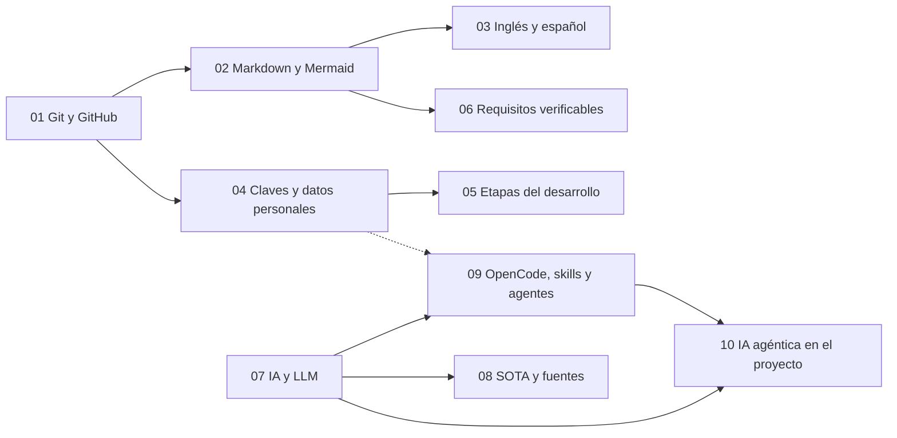
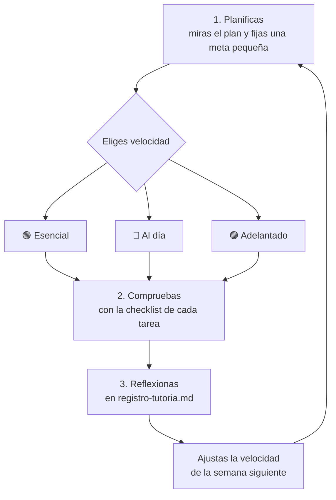
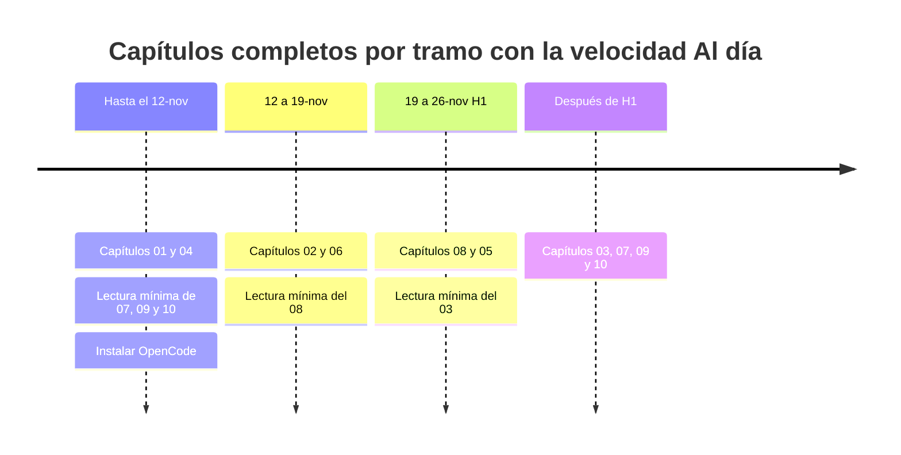

# 00 · Fundamentos del proyecto

> **Borrador pendiente de revisión del profesor.** Las fechas son **provisionales** hasta que se apruebe el calendario del centro ([fases-del-proyecto.md](../../fases-del-proyecto.md)).

Diez capítulos para que tengas las bases con las que vamos a trabajar el proyecto: Git y GitHub, documentar, proteger datos, entender las etapas, trabajar con requisitos, y usar la IA con criterio. **No hace falta leerlo todo de golpe.** Cada capítulo empieza con *En 5 minutos* y *Lo imprescindible*: empieza por ahí y vuelve a leer el resto cuando lo necesites.

## Qué vas a encontrar

| Cap. | Tema | Para qué te sirve |
|---|---|---|
| [01](01-git-y-github.md) | Git y GitHub: ramas, commits, Pull Request y merge | Hacer tu primer Pull Request y trabajar como en un proyecto real |
| [02](02-documentar-markdown-mermaid.md) | Documentar con Markdown y Mermaid | Escribir tu documentación y tus diagramas en GitHub |
| [03](03-documentar-en-ingles-y-espanol.md) | Documentar en inglés y en español | Entender por qué y cómo vamos a tener las dos lenguas |
| [04](04-claves-y-datos-personales.md) | Claves y datos personales (RGPD, LOPDGDD, AEPD) | No subir nunca lo que no se debe a un repositorio |
| [05](05-etapas-de-desarrollo.md) | Etapas del desarrollo de software | Saber en qué fase estás y qué te falta |
| [06](06-requisitos-verificables.md) | Requisitos verificables | Escribir requisitos que se puedan comprobar (RA1, 1f) |
| [07](07-ia-y-llm.md) | La IA y los LLM | Saber qué es y qué no es una IA generativa |
| [08](08-sota-y-fuentes.md) | SOTA y contraste de fuentes | No fiarte de nada sin fuente, tampoco de la IA |
| [09](09-opencode-skills-agentes.md) | OpenCode, skills y agentes | Usar la herramienta de IA del proyecto |
| [10](10-ia-agentica-en-el-proyecto.md) | La IA agéntica en nuestro proyecto | Qué usamos, cuándo y cómo se declara |
| [Glosario](glosario.md) | Glosario común | Consultar siglas y términos (PR, RA1, token, `.env`…) sin perderte |

Este diagrama es el mapa de capítulos: cada flecha indica «lee esto antes que esto», según el apartado *Antes de empezar* o *Antes de leer esto* de cada capítulo.

**Cómo leerlo:** hay dos ramas. La de Git (01 a 06) empieza en el 01 y de ahí salen 02 y 04. La de IA (07 a 10) empieza en el 07 y llega al 10 pasando por el 09. La flecha punteada del 04 al 09 indica que el 09 recomienda conocer antes qué no pegar en una herramienta de IA.

## Tres velocidades de aprendizaje: tú eliges cada semana

No todas las personas aprenden a la misma velocidad, y eso es normal. Por eso hay **tres velocidades** dentro de los mismos capítulos, y **eres tú quien elige** cuál te conviene cada semana (no hace falta que lo declares: se ve en tu trabajo): así aprendes a **autorregularte** (decidir cuánto puedes hacer, comprobar cómo vas y ajustar). Puedes **cambiar de velocidad cuando quieras**, hacia arriba o hacia abajo, sin que cuente como algo bueno ni malo. Los **hitos son los mismos para todos** (H1 26-nov, H2 21-ene, H3 7-may).

| Velocidad | Para quién | Qué haces | Tiempo orientativo* |
|---|---|---|---|
| 🟢 **Esencial** | Esta semana vas justo/a de tiempo o de conocimientos | Solo lo imprescindible para **no quedarte atrás**: *En 5 minutos* + *Lo imprescindible* y los primeros pasos de la tarea | 30-45 min |
| 🔵 **Al día** | Puedes seguir el ritmo del grupo | El capítulo completo y su tarea con checklist | 60-90 min |
| 🟣 **Adelantado** | Has terminado lo de la semana y quieres más | Lo de la velocidad azul **más** [retos de ampliación](ampliaciones.md) (9 en el curso, 3 por bloque de hito; propuesta, pendiente de aprobación: con al menos 6 de 9 se sumaría 1 punto, una sola vez, si tu nota del proyecto sin el punto es al menos 5; detalle en `ampliaciones.md`) o adelantar trabajo de tu proyecto | +30-60 min |

\* Tiempos sin calibrar (propuesta). Si algo te lleva el doble, es información útil: anótalo en `docs/registro-tutoria.md`.

**Cómo te autorregulas en cada semana** (un ciclo de tres pasos, basado en el modelo de aprendizaje autorregulado de Zimmerman):
1. **Antes — planifica:** mira el plan de la semana, elige tu velocidad y fíjate una meta pequeña («esta semana llego a mi primer PR»).
2. **Durante — comprueba:** usa la checklist de cada tarea para ver qué llevas hecho y qué te queda. Si te atascas más de 10 minutos, anótalo como bloqueo.
3. **Después — reflexiona:** en `docs/registro-tutoria.md` apunta las horas, qué te costó, qué te salió bien y si la semana que viene cambias de velocidad.

Este diagrama muestra el ciclo semanal y las tres velocidades entre las que eliges al planificar.

**Cómo leerlo:** cada semana empiezas planificando y eligiendo una velocidad, trabajas comprobando con la checklist y terminas reflexionando en el registro de tutoría. Lo que anotes decide si la semana siguiente subes, bajas o mantienes la velocidad.

**Si vas justo/a:** la velocidad 🟢 está pensada para que llegues a cada hito. Si ni siquiera eso te cabe, **díselo al tutor por correo** ([contacto y ayuda](../contacto-y-ayuda.md)) o en el briefing semanal: se ajusta contigo, no pasa nada por pedir ayuda.
**Si vas sobrado/a:** los retos son opcionales, y **ayudar a un compañero** (explicarle algo que ya sabes) es una de las mejores formas de aprender.

### Plan semanal por velocidad (propuesta, sin calibrar)

Esta línea del tiempo resume qué capítulos completos toca en cada tramo si vas a la velocidad 🔵 Al día; la tabla de debajo da el detalle de las tres velocidades.

**Cómo leerlo:** de izquierda a derecha pasan las semanas hasta el hito H1 (26-nov) y después. En cada tramo ves qué capítulos lees enteros y de cuáles solo la lectura mínima.

| Cuándo | 🟢 Esencial | 🔵 Al día | 🟣 Adelantado (opcional) |
|---|---|---|---|
| **Hasta el 12-nov** | [01](01-git-y-github.md): *En 5 min* + *Imprescindible* + pasos 1-4 de la tarea (llegas a tu primer PR) · [04](04-claves-y-datos-personales.md): *Imprescindible* | 01 y 04 completos · [07](07-ia-y-llm.md), [09](09-opencode-skills-agentes.md) (solo «chat principal») y [10](10-ia-agentica-en-el-proyecto.md) (sesión 1): lectura mínima · instalar OpenCode | Reto [H1-1](ampliaciones.md#reto-h1-1--valida-tu-necesidad-con-una-persona-real) (mejora tu necesidad en `01-analisis`) |
| **12 a 19-nov** | [06](06-requisitos-verificables.md): *Imprescindible* · [02](02-documentar-markdown-mermaid.md): *Imprescindible* | 02 y 06 completos · [08](08-sota-y-fuentes.md): lectura mínima | Reto [H1-2](ampliaciones.md#reto-h1-2--requisitos-verificables-y-trazabilidad-de-tu-proyecto) (requisitos y trazabilidad de tu proyecto) |
| **19 a 26-nov (H1)** | [08](08-sota-y-fuentes.md): *Imprescindible* (fuente + fecha + estado) | 08 y [05](05-etapas-de-desarrollo.md) completos · [03](03-documentar-en-ingles-y-espanol.md): lectura mínima | Reto [H1-3](ampliaciones.md#reto-h1-3--estado-del-arte-y-fuentes-de-tu-proyecto) (`01b-sota.md`) |
| **Después de H1** | 03, 07, 09 y 10: *Imprescindible* | 03, 07, 09 y 10 completos | Los retos de este bloque se liberarán con la planificación de H2; mientras tanto, adelantar el esqueleto de `02-diseno.md` |

Cada capítulo termina con una **tarea y una checklist** para saber qué llevas hecho y qué te queda. *Lectura mínima* = *En 5 minutos* + *Lo imprescindible*.

**Adelantar trabajo de tu proyecto:** ver las reglas al final de [ampliaciones.md](ampliaciones.md#adelantar-el-trabajo-de-tu-proyecto).

## Reglas que valen para todos los capítulos

- La IA se puede usar y **se declara** en `docs/declaracion-uso-ia.md`. La IA no califica. El proyecto lo defiendes tú.
- **Nunca** claves ni datos personales en el repositorio ni en un chat de IA.
- Todo dato externo lleva **fuente, fecha y estado**: `verificado` (lo has abierto y leído), `declarado` o `no leído`.
- Si te atascas más de 10 minutos, anótalo como bloqueo en `docs/registro-tutoria.md` y, si no sales, escribe por correo ([contacto y ayuda](../contacto-y-ayuda.md)): no es una nota negativa, es para ayudarte.
- Si la IA o la cuota fallan, sigue trabajando sin ella.

## Estado de estos capítulos

Redactados el 2026-11-07 con ayuda de IA y **verificados en parte** con fuentes oficiales. Cada capítulo indica en *Para saber más* qué se comprobó y qué no. El diagrama Mermaid de cada uno se ve en la vista previa de GitHub; si alguno no se dibuja, avísanos.

## Fuentes sobre la autorregulación del aprendizaje (consultadas el 2026-11-07)

| Fuente | Estado |
|---|---|
| Resultados de búsqueda sobre el modelo de Zimmerman (previsión, ejecución, autorreflexión): [libros.catedu.es](https://libros.catedu.es/books/b2-sociolinguistico-area-3-ensenanza-y-aprendizaje/chapter/34-aprendizaje-autorregulado/export/pdf) y [digibug.ugr.es](https://digibug.ugr.es/bitstream/handle/10481/22995/rev161ART9.pdf?sequence=1) | `declarado` (se leyó el resumen del buscador, no el documento completo) |
