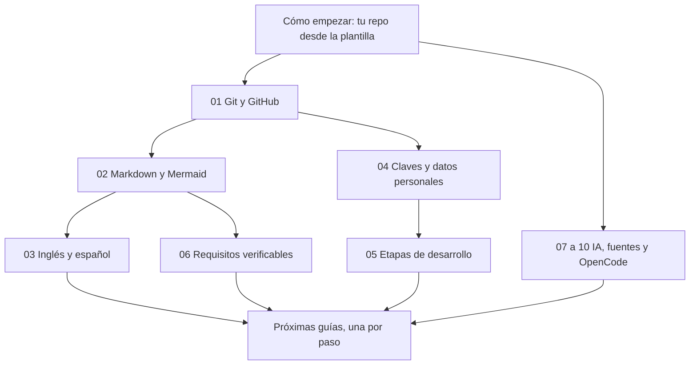

# Guía del proyecto

Cómo hacer, paso a paso, cada tarea de tu proyecto. Esta carpeta irá creciendo con una guía por paso; por ahora, el primero: cómo empezar tu repositorio. La plantilla vive en [`plantilla-proyecto/`](../../plantilla-proyecto/) (raíz de este repositorio): es la **única copia**, no hay otra versión aquí.

## Cómo empezar

1. Crea tu repositorio de proyecto en tu cuenta de GitHub: `proyecto-daw-<tu-apellido>`.
2. Copia en él el contenido de [`plantilla-proyecto/`](../../plantilla-proyecto/). Para la sesión de Inicio basta con [`docs/00-documentoInicio.md`](../../plantilla-proyecto/docs/00-documentoInicio.md); el resto de plantillas las usarás según toque.
3. Rellena `docs/00-documentoInicio.md`.
4. Trabaja en una **rama**, haz commits con mensajes convencionales y abre un **Pull Request** a `main`. El tutor lo revisa y lo aprueba; después lo integras tú.

El calendario y las fases están en [`../fases-del-proyecto.md`](../fases-del-proyecto.md) y la metodología en [`../metodologia.md`](../metodologia.md).

## Mapa del itinerario

Este mapa muestra por dónde empezar y qué guía conviene leer antes de cuál (según el «Antes de empezar» de cada tarea). Lo que sigue a las guías de fundamentos son las próximas guías, una por paso del proyecto.

**Cómo leerlo:** empieza por «Cómo empezar» y por la 01; de ahí salen la 02 y la 04. Las guías 07 a 10 (IA y fuentes) puedes leerlas en paralelo. Las flechas indican orden recomendado, no obligatorio; el plan semanal está en el [README de fundamentos](00-fundamentos/README.md).

## Guías

| Guía | Qué es |
|---|---|
| [00 · Fundamentos](00-fundamentos/README.md) | Las bases: Git y GitHub, documentar, datos, etapas, requisitos, IA y OpenCode |
| [Cómo pedir ayuda](contacto-y-ayuda.md) | El canal de ayuda: cuándo escribir al tutor, cómo preparar la consulta y qué no enviar nunca |
| [Entrega de hito](entrega-de-hito.md) | Integrar el PR de entrega, poner el tag (`h1`), comprobarlo y avisar con el hash *(borrador)* |
